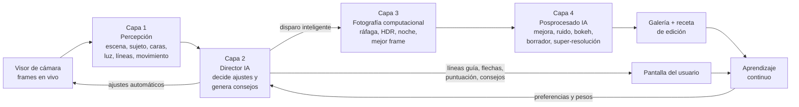
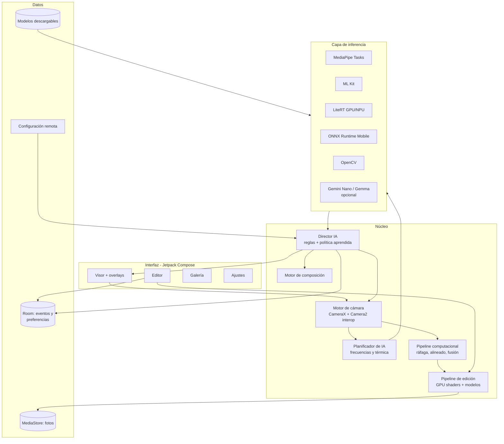

# Plan de creación — IA Cámara

> Una cámara para Android construida alrededor de la IA: analiza la escena antes de disparar,
> decide sola la mejor configuración, te guía para encuadrar como un profesional,
> aplica fotografía computacional al disparar y mejora la foto después.
> Todo lo esencial funciona **gratis, sin internet y sin enviar tus fotos a ningún servidor**.

Nombre de trabajo: **IA Cámara** (se puede cambiar). Plataforma: **Android (APK)**.
Fecha del plan: noviembre de 2026.

---

## Índice

1. [Visión y principios](#1-visión-y-principios)
2. [Cómo funciona la IA: las 4 capas](#2-cómo-funciona-la-ia-las-4-capas)
3. [Arquitectura técnica](#3-arquitectura-técnica)
4. [Tecnología elegida y por qué](#4-tecnología-elegida-y-por-qué)
5. [Catálogo de modelos de IA gratuitos](#5-catálogo-de-modelos-de-ia-gratuitos)
6. [Capa 1 — Percepción en vivo (antes del disparo)](#6-capa-1--percepción-en-vivo-antes-del-disparo)
7. [Capa 2 — El "Director IA": decisión autónoma](#7-capa-2--el-director-ia-decisión-autónoma)
8. [Coach de composición: líneas guía, ángulos y consejos](#8-coach-de-composición-líneas-guía-ángulos-y-consejos)
9. [Capa 3 — Fotografía computacional al disparar](#9-capa-3--fotografía-computacional-al-disparar)
10. [Capa 4 — Posprocesado con IA](#10-capa-4--posprocesado-con-ia)
11. [IA generativa y conversacional (el "fotógrafo veterano")](#11-ia-generativa-y-conversacional-el-fotógrafo-veterano)
12. [Aprendizaje continuo: cómo evoluciona la app](#12-aprendizaje-continuo-cómo-evoluciona-la-app)
13. [Rendimiento, batería y niveles de dispositivo](#13-rendimiento-batería-y-niveles-de-dispositivo)
14. [Experiencia de usuario y modos](#14-experiencia-de-usuario-y-modos)
15. [Privacidad, licencias y límites reales](#15-privacidad-licencias-y-límites-reales)
16. [Hoja de ruta por fases (hasta el APK v1.0)](#16-hoja-de-ruta-por-fases-hasta-el-apk-v10)
17. [Qué añadir después (versión 2 y más)](#17-qué-añadir-después-versión-2-y-más)
18. [Estructura del proyecto y cómo se generará el APK](#18-estructura-del-proyecto-y-cómo-se-generará-el-apk)
19. [Decisiones pendientes](#19-decisiones-pendientes)
20. [Fuentes consultadas](#20-fuentes-consultadas)

---

## 1. Visión y principios

**Objetivo:** que cualquier persona, sin saber de fotografía, saque fotos de nivel profesional
porque la app "piensa" como un fotógrafo con años de experiencia: mira la escena, decide la
técnica, te dice dónde moverte y dispara en el momento justo.

**Principios de diseño**

| Principio | Qué significa en la práctica |
|---|---|
| **IA primero** | Por defecto la app está en modo *Auto IA*: el usuario solo apunta; la IA decide modo, exposición, enfoque, lente, HDR, noche, ráfaga y edición. |
| **En el dispositivo (on-device)** | Toda la IA esencial corre en el móvil (CPU/GPU/NPU). Gratis, sin conexión, sin límites de uso y privada. La nube es un extra opcional. |
| **Enseña mientras ayuda** | Cada decisión se puede explicar ("he subido la exposición porque el sujeto está a contraluz"). El usuario aprende fotografía usando la app. |
| **Nunca estorba** | Los consejos son breves, visuales y se pueden ocultar. El disparo siempre es instantáneo (cero retraso de obturador). |
| **Natural, no artificial** | La mejora debe parecer una buena foto, no un filtro. Retoque de piel y efectos fuertes solo si el usuario los pide. |
| **Siempre mejorando** | Aprende tus gustos localmente y recibe modelos y reglas mejores mediante actualizaciones. |
| **No destructivo** | Se guarda la foto original + una "receta" de edición; cualquier mejora se puede deshacer. |

---

## 2. Cómo funciona la IA: las 4 capas



1. **Percepción (antes del disparo):** varios modelos ligeros analizan el visor en tiempo real.
2. **Director IA (decisión):** combina todas las señales y decide la configuración de la cámara
   y qué consejo mostrar. Es el "cerebro" de la app.
3. **Fotografía computacional (en el disparo):** ráfaga, fusión HDR, modo noche multiframe,
   selección del mejor fotograma.
4. **Posprocesado (después del disparo):** mejora automática por escena y herramientas IA.

Más una capa transversal de **aprendizaje continuo** que ajusta al Director IA con el tiempo.

---

## 3. Arquitectura técnica



**Flujo de un frame del visor**

1. CameraX entrega dos flujos: `Preview` (lo que ves) y `ImageAnalysis` (copia reducida, ~640×480 YUV).
2. El **Planificador de IA** decide qué modelos corren en ese frame (no todos corren siempre, ver §13).
3. Los resultados se fusionan en un `SceneState` (escena, sujeto, caras, luz, horizonte, estabilidad…).
4. El **Director IA** transforma el `SceneState` en `CaptureSettings` (ajustes) + `Guidance` (consejos).
5. Los ajustes se aplican a la cámara de forma suave (sin saltos bruscos) y los consejos se dibujan encima del visor.

---

## 4. Tecnología elegida y por qué

| Área | Elección | Motivo |
|---|---|---|
| Lenguaje | **Kotlin** nativo | Acceso completo a la cámara y a los aceleradores; Flutter/React Native limitan el control manual y añaden latencia. |
| Interfaz | **Jetpack Compose + Material 3** | Moderno, rápido para crear overlays animados. |
| Cámara | **CameraX** + **Camera2 Interop** | CameraX simplifica preview/captura/análisis y da acceso a *Extensions* (HDR, Noche, Bokeh del fabricante) y a Ultra HDR; Camera2 Interop permite ISO, velocidad de obturación y enfoque manual cuando el móvil lo soporta. |
| Visión en vivo | **MediaPipe Tasks Vision** | Detector de objetos, caras (landmarks), pose, segmentación y clasificación listos para usar, gratis y offline. |
| Visión adicional | **ML Kit** | Detección de caras rápida, etiquetado de imágenes, segmentación de sujeto, escáner de documentos. |
| Modelos propios | **LiteRT** (antes TensorFlow Lite) | Runtime oficial de Google para IA en el móvil con aceleración GPU y NPU y fallback automático a CPU. |
| Modelos no convertibles | **ONNX Runtime Mobile** | Para modelos de investigación (p. ej. NAFNet) que se exportan mejor a ONNX. |
| Visión clásica | **OpenCV** (Apache 2.0) | Líneas, horizonte, alineado de ráfagas, fusión de exposiciones, CLAHE, nitidez. |
| LLM en el móvil | **ML Kit GenAI Prompt API (Gemini Nano)** y, como alternativa, **Gemma vía LiteRT-LM** | Consejos en lenguaje natural y crítica de fotos sin internet, en móviles compatibles. |
| Nube (opcional) | **Gemini API** (capa gratuita) vía **Firebase AI Logic** + App Check | Análisis profundo opcional; nunca se incrusta la clave en el APK. |
| Edición GPU | **AGSL RuntimeShader** (Android 13+) / **OpenGL ES** | Ajustes en tiempo real (tono, LUT, curvas) sin gastar CPU. |
| Datos | **Room** + **DataStore** | Historial de decisiones, preferencias y aprendizaje local. |
| Tareas pesadas | **WorkManager** | Procesar mejoras largas (super-resolución, noche) en segundo plano. |
| Inyección | **Hilt** · **Coroutines/Flow** | Arquitectura limpia y reactiva. |
| Actualización remota | **Firebase Remote Config** (gratuito) + descarga de modelos | Mejorar reglas y modelos sin publicar otro APK. |
| Compilación | **Gradle KTS** + **GitHub Actions** | El APK se genera automáticamente en la nube con cada cambio. |

> Nota: las versiones exactas de cada librería se fijarán al crear el proyecto (Fase 0) tomando la
> última estable. A fecha de este plan, CameraX tiene la serie 1.7 en *release candidate*, la API
> moderna de LiteRT (CompiledModel) sigue madurando y la Prompt API de Gemini Nano está en beta,
> así que todo lo que dependa de APIs no estables tendrá un camino alternativo estable.

---

## 5. Catálogo de modelos de IA gratuitos

Todos son gratuitos y pueden ejecutarse en el móvil. **La licencia importa** si algún día se publica
la app en Google Play o se cobra por ella.

### 5.1 Antes del disparo (tiempo real)

| Función | Modelo recomendado | Runtime | Licencia | Notas |
|---|---|---|---|---|
| Tipo de escena (retrato, paisaje, comida, noche, nieve, atardecer, documento, mascota…) | **MobileNetV3 / EfficientNet-Lite** reentrenado en categorías fotográficas (base: Places365 + etiquetas propias) · alternativa rápida: **ML Kit Image Labeling** | LiteRT / ML Kit | Apache 2.0 | ~3–5 MB, 2–4 veces por segundo. |
| Detección de sujetos/objetos | **MediaPipe Object Detector (EfficientDet-Lite0/2)** · más preciso: **RF-DETR** o **YOLOX** (Apache 2.0) | MediaPipe / LiteRT | Apache 2.0 | **Evitar Ultralytics YOLO**: es AGPL-3.0 y obligaría a liberar todo el código de la app o pagar licencia. |
| Caras, ojos abiertos, sonrisa, dirección de la mirada | **MediaPipe Face Landmarker** (478 puntos + blendshapes) · **ML Kit Face Detection** | MediaPipe / ML Kit | Apache 2.0 | Detecta parpadeos y sonrisas para el disparo inteligente. |
| Pose del cuerpo | **MediaPipe Pose Landmarker** | MediaPipe | Apache 2.0 | Evita cortar en articulaciones y da consejos de pose. |
| Separar sujeto y fondo | **MediaPipe Image Segmenter** (selfie / multiclase) · **ML Kit Subject Segmentation** | MediaPipe / ML Kit | Apache 2.0 | Base para retrato, cielo y bokeh. |
| Sujeto principal sin clase conocida (saliencia) | **U²-Net (versión pequeña)** | LiteRT | Apache 2.0 | "¿Qué es lo importante en esta imagen?". |
| Calidad estética del encuadre | **NIMA (MobileNet) — versión LiteRT** (estético + técnico) | LiteRT GPU | Apache 2.0 | ~6,4 MB cada uno, puntuación 1–10. |
| Líneas, horizonte, puntos de fuga | **OpenCV** (LSD / Hough) + sensores del móvil | OpenCV | Apache 2.0 | No necesita red neuronal. |
| Profundidad | **Depth Anything V2 Small** · alternativa: **MiDaS small** | LiteRT / ONNX | Apache 2.0 (solo la versión *Small*) / MIT | Las versiones Base/Large de Depth Anything son **no comerciales**. |
| Documentos | **ML Kit Document Scanner** | ML Kit | Gratis (términos de Google) | Recorte y corrección de perspectiva automáticos. |

### 5.2 En el disparo

| Función | Tecnología | Notas |
|---|---|---|
| HDR / Noche / Bokeh / Retoque del fabricante | **CameraX Extensions** | Si el fabricante las expone, son la mejor calidad posible y gratis. |
| HDR propio | Horquillado de exposición + alineado (OpenCV) + **fusión de exposiciones Mertens** | Para móviles sin extensión HDR. |
| Noche propia | Ráfaga de 6–15 frames + alineado + promediado robusto + **Zero-DCE** | Reduce ruido y aclara sombras. |
| Mejor fotograma | Nitidez (varianza Laplaciana) + ojos abiertos + NIMA | De una ráfaga se elige el mejor automáticamente. |
| Ultra HDR | Formato **JPEG_R** (Android 14+) | Fotos con más brillo y rango en pantallas HDR, compatibles con JPEG normal. |
| RAW | **DNG** vía Camera2 (si el sensor lo permite) | Para el modo Pro. |

### 5.3 Después del disparo

| Función | Modelo recomendado | Licencia | Notas |
|---|---|---|---|
| Mejora en poca luz | **Zero-DCE** (versión LiteRT) | Apache 2.0 | Diminuto (~0,18 MB fp16), corre entero en GPU. |
| Reducción de ruido y desenfoque | **NAFNet** (denoise / deblur) | MIT | Vía ONNX Runtime; procesado por bloques (*tiles*). |
| Super-resolución / zoom IA | **Real-ESRGAN x4plus** (versión optimizada para NPU de Qualcomm AI Hub) · alternativa ligera: ESRGAN-lite | BSD-3 | ~40–70 ms por bloque en gama alta Snapdragon. |
| Borrador mágico (eliminar objetos) | **LaMa** · alternativa móvil más ligera: **MI-GAN** | Apache 2.0 / verificar | Inpainting por bloques alrededor de la zona marcada. |
| Bokeh / modo retrato posterior | Segmentación + **Depth Anything V2 Small** + desenfoque de lente simulado | Apache 2.0 | Enfoque editable después de la foto. |
| Cielo (mejorar o realzar) | Segmentación de cielo + curvas locales | Apache 2.0 | Sin reemplazo falso por defecto. |
| Recorte y enderezado inteligente | Motor de composición (§8) + NIMA | — | Propone 3 recortes ordenados por puntuación. |
| Color y tono automático por escena | Curvas + LUT 3D + balance de blancos aprendido | — | Shader GPU, instantáneo. |
| Retoque de piel natural (opcional) | MediaPipe Face Landmarker + filtro bilateral guiado | Apache 2.0 | Solo si el usuario lo activa. |

### 5.4 IA de lenguaje (consejos y crítica)

| Opción | Dónde corre | Coste | Cuándo usarla |
|---|---|---|---|
| **Gemini Nano** (ML Kit GenAI Prompt API, admite imagen + texto) | En el móvil | Gratis | Móviles compatibles (p. ej. Pixel 10 y otros de gama alta). Solo con la app en primer plano y con cuota por app. |
| **Gemma** (3n / 4) vía **LiteRT-LM** | En el móvil | Gratis | Paquete opcional para gama alta sin Gemini Nano; descarga de varios GB. |
| **Gemini API** (capa gratuita) | Nube | Gratis con límites | Solo si el usuario lo activa. Los límites gratuitos cambian a menudo y el contenido enviado en la capa gratuita puede usarse para mejorar productos de Google: se pedirá consentimiento explícito. |
| **Plantillas de consejos** (sin LLM) | En el móvil | Gratis | Siempre disponible; es la base y funciona en cualquier móvil. |

---

## 6. Capa 1 — Percepción en vivo (antes del disparo)

El objetivo es construir, varias veces por segundo, un `SceneState` con todo lo que un fotógrafo
observaría antes de disparar:

| Señal | Cómo se obtiene | Para qué sirve |
|---|---|---|
| **Tipo de escena** | Clasificador de escena (§5.1) suavizado en el tiempo | Elegir estrategia general (retrato, paisaje, comida…). |
| **Sujeto principal** | Caras > personas > animales > objeto detectado > mapa de saliencia | Enfocar, medir la luz y componer alrededor de él. |
| **Caras** | Face Landmarker: posición, tamaño, ojos, sonrisa, giro de cabeza | Retrato, disparo cuando todos tienen los ojos abiertos. |
| **Pose** | Pose Landmarker | No cortar en codos/rodillas, consejos de postura. |
| **Luz** | Histograma de luminancia del plano Y + metadatos (ISO, exposición, temperatura de color) + sensor de luz | Detectar contraluz, poca luz, luces quemadas, rango dinámico. |
| **Horizonte e inclinación** | Sensor de rotación (giroscopio/acelerómetro) + líneas detectadas | Nivel, corregir verticales en arquitectura. |
| **Líneas y fugas** | OpenCV LSD + agrupación de líneas | Líneas guía (*leading lines*), simetría. |
| **Movimiento** | Giroscopio (temblor de la mano) + desplazamiento del sujeto entre frames | Velocidad de obturación, aviso "mantén quieto", modo acción. |
| **Distancia/profundidad** | Distancia de enfoque (metadatos) + modelo de profundidad a baja frecuencia | Macro, retrato, bokeh. |
| **Calidad estética** | NIMA 1 vez por segundo | Parte de la puntuación de encuadre. |

**Estabilización temporal:** todas las señales se suavizan (media móvil / histéresis) para que la
escena no "parpadee" entre categorías y los ajustes no salten. Una escena solo cambia si se mantiene
~0,5 s.

---

## 7. Capa 2 — El "Director IA": decisión autónoma

Es el módulo que decide como lo haría un fotógrafo profesional. Funciona en dos niveles:

1. **Motor experto de reglas** (desde el día 1): conocimiento fotográfico codificado, explicable y fiable.
2. **Política aprendida** (Fase 7): pesos y preferencias que se ajustan con el uso y con actualizaciones remotas.

### 7.1 Qué controla de forma autónoma

- Modo de captura: normal, HDR, noche, retrato, acción, macro, documento.
- Lente/zoom: ultra gran angular, principal, teleobjetivo (p. ej. retrato a 2× para evitar distorsión).
- Punto de enfoque y medición: siempre sobre el sujeto (ojos si hay cara), con seguimiento.
- Compensación de exposición (EV) e, *si el móvil lo permite*, ISO y velocidad de obturación manuales.
- Balance de blancos (protegiendo tonos de piel y atardeceres).
- Flash / luz de relleno.
- Número de fotos de la ráfaga y si usa extensión del fabricante o pipeline propio.
- Estilo de revelado posterior (curvas, saturación, nitidez por escena).
- Momento de disparo (disparo inteligente, §8.5).

### 7.2 Matriz de decisión inicial (ejemplos)

| Escena detectada | Señales clave | Decisión automática | Consejo mostrado |
|---|---|---|---|
| **Retrato** | Cara > 5 % del encuadre | Extensión Bokeh o retrato propio · enfoque y medición en los ojos · 2× o tele si existe · ráfaga de 5 y elegir ojos abiertos | "Baja a la altura de sus ojos" · "Deja aire sobre la cabeza" · "No cortes por rodillas o codos" |
| **Contraluz** | Histograma bimodal, sujeto oscuro y fondo quemado | HDR (extensión o fusión propia) · medir en el sujeto · +EV · sugerir flash de relleno | "Gira un poco para que la luz le dé de lado" |
| **Paisaje** | Clase paisaje, sin caras, enfoque lejano | ISO mínimo · HDR si el rango dinámico es alto · gran angular · nivel de horizonte | "Horizonte en el tercio inferior si el cielo es bonito" · "Busca algo interesante en primer plano" |
| **Poca luz / noche** | ISO alto en metadatos, poca luz | Extensión Noche o multiframe propio (6–15 frames según el temblor) | "Apoya el móvil o mantén quieto 2 s" |
| **Comida** | Clase comida | Plato plano → vista cenital (90°); vaso, hamburguesa o tarta → 45° · calidez y saturación sutiles | "Usa luz de ventana lateral, evita el flash" |
| **Arquitectura** | Muchas líneas verticales convergentes | Avisar de inclinación · corrección de perspectiva posterior | "Pon el móvil recto: 0° de inclinación" |
| **Acción / niños / mascotas** | Sujeto se mueve rápido | Obturación rápida (≤ 1/500 s si hay control manual) · ráfaga · enfoque con seguimiento | "Baja a la altura del animal" |
| **Atardecer / cielo** | Clase atardecer, tonos cálidos | −EV para no quemar el cielo · conservar cálidos | "Pon el sol en un punto fuerte de la rejilla" |
| **Macro** | Sujeto muy cerca | Lente macro si existe · enfoque preciso · f/ISO bajos | "Acércate despacio hasta que se vea nítido" |
| **Documento** | Detector de documento | Escáner ML Kit · alto contraste | "Encuadra las 4 esquinas" |

### 7.3 Cómo decide (estructura interna)

```kotlin
// Esquema simplificado del Director IA
data class SceneState(
    val scene: SceneType, val sceneConfidence: Float,
    val subject: Subject?, val faces: List<FaceInfo>,
    val light: LightInfo,          // histograma, rango dinámico, contraluz, lux
    val motion: MotionInfo,        // temblor de la mano, velocidad del sujeto
    val horizon: HorizonInfo,      // inclinación, líneas
    val aesthetic: Float,          // NIMA
)

interface Policy { fun decide(state: SceneState, device: DeviceCaps, prefs: UserPrefs): Decision }

data class Decision(
    val settings: CaptureSettings,  // modo, lente, EV, ISO, obturación, WB, flash, ráfaga
    val guidance: Guidance,         // líneas, flechas, puntuación, consejo, motivo
    val reasons: List<String>,      // "Contraluz detectado → +1 EV y HDR"
)
```

- `RuleBasedPolicy` (Fase 2–3) implementa la tabla anterior.
- `LearnedPolicy` (Fase 7) envuelve a la de reglas y ajusta sus parámetros con las preferencias del usuario.
- `DeviceCaps` describe lo que permite cada móvil (nivel de hardware Camera2, control manual, RAW,
  extensiones disponibles, lentes, NPU, Gemini Nano). **La IA nunca pide algo que el móvil no puede hacer.**

---

## 8. Coach de composición: líneas guía, ángulos y consejos

### 8.1 Líneas guía dinámicas (se adaptan a lo que detecta)

- **Rejilla de tercios** con los 4 puntos fuertes resaltados cuando el sujeto se acerca a uno.
- **Espiral áurea / proporción áurea** cuando hay un sujeto claro y espacio negativo.
- **Eje de simetría** cuando detecta escena simétrica (arquitectura, reflejos).
- **Nivel de horizonte** (verde cuando está recto) y **nivel vertical** para arquitectura.
- **Líneas guía detectadas** resaltadas para que el usuario las use hacia el sujeto.
- **Caja del sujeto** y **posición objetivo**: un hueco fantasma que muestra dónde debería estar el sujeto.

### 8.2 Puntuación de encuadre (0–100)

```
Puntuación = Σ peso_i(escena) × criterio_i
```

| Criterio | Qué mide |
|---|---|
| Tercios / proporción áurea | Distancia del sujeto al punto fuerte más adecuado |
| Horizonte | Inclinación y posición (tercio superior/inferior) |
| Aire sobre la cabeza | Espacio entre la cabeza y el borde superior |
| Espacio de mirada / movimiento | Más espacio hacia donde mira o se mueve el sujeto |
| Cortes | No cortar en articulaciones, ni dejar el sujeto pegado al borde |
| Equilibrio visual | Distribución del "peso" (saliencia) en la imagen |
| Fondo limpio | Objetos que "salen" de la cabeza, bordes distractores |
| Exposición | Luces quemadas y sombras empastadas en el sujeto |
| Nitidez / estabilidad | Temblor y desenfoque |
| Estética global | NIMA |

Los pesos dependen de la escena (en paisaje pesa el horizonte; en retrato, los ojos y el aire sobre la
cabeza) y más adelante se personalizan (§12).

### 8.3 Flechas de movimiento

El motor calcula dónde debería estar el sujeto (punto fuerte elegido según la dirección de la mirada)
y el tamaño ideal, y lo traduce en indicaciones sencillas:

- "← Mueve el móvil un poco a la izquierda" · "Acércate" / "Aléjate" · "Baja la cámara" · "Gira a horizontal".
- Vibración suave (háptica) cuando el encuadre llega a la zona óptima.
- Guía por voz opcional (TTS) para quien prefiera no mirar la pantalla.

### 8.4 Consejos de ángulo por tipo de escena

Biblioteca de conocimiento fotográfico (ampliable por actualización remota). Ejemplos:

- **Retrato:** altura de los ojos; ligero ángulo de 3/4; luz lateral suave; evitar luz cenital del mediodía.
- **Grupo:** todos a la misma distancia de la cámara; los más altos detrás.
- **Paisaje:** primer plano + plano medio + fondo; hora dorada; horizonte recto.
- **Comida:** cenital para platos planos, 45° para comida con altura; luz de ventana.
- **Arquitectura:** móvil vertical para no deformar; buscar simetría o diagonales.
- **Mascotas y niños:** a su altura; ráfaga; enfocar los ojos.
- **Producto:** fondo limpio; luz difusa; ángulo de 3/4.
- **Noche:** apoyar el móvil; evitar el zoom digital.

### 8.5 Disparo inteligente (opcional)

La app dispara sola (o avisa) cuando se cumplen a la vez: puntuación ≥ umbral, móvil estable ~300 ms,
enfoque bloqueado, ojos abiertos y, si procede, sonrisa. En grupos, espera a que **todos** tengan los
ojos abiertos.

---

## 9. Capa 3 — Fotografía computacional al disparar

1. **Cero retraso de obturador:** CameraX en modo de mínima latencia y búfer de frames recientes.
2. **Estrategia elegida por el Director IA:**
   - Si el fabricante ofrece la **extensión** adecuada (HDR, Noche, Bokeh) → se usa (máxima calidad).
   - Si no → **pipeline propio**:
     - *HDR:* 3 exposiciones (−2, 0, +2 EV) → alineado → fusión Mertens → mapeo de tonos.
     - *Noche:* 6–15 frames cortos → alineado robusto → promedio con rechazo de fantasmas → Zero-DCE + reducción de ruido.
     - *Acción / retrato:* ráfaga corta → se elige el frame más nítido con ojos abiertos.
3. **Formato:** JPEG de alta calidad, **Ultra HDR (JPEG_R)** en Android 14+ y **RAW (DNG)** en el modo Pro.
4. **Metadatos:** EXIF completo + datos de la decisión de la IA (escena, motivo) para el aprendizaje y el editor.
5. **Vista inmediata:** se muestra una vista previa al instante y el procesamiento pesado continúa en segundo plano.

---

## 10. Capa 4 — Posprocesado con IA

### 10.1 Mejora automática (sin tocar nada)

Tras cada foto se aplica una "receta" según la escena: balance de blancos, curvas, contraste local
(CLAHE), saturación selectiva, protección de tonos de piel, nitidez adaptativa y reducción de ruido.
Se guarda **original + versión mejorada**.

### 10.2 Herramientas del editor

| Herramienta | Qué hace |
|---|---|
| **Mejorar ✨** | Un toque: la mejor versión según la IA (con intensidad ajustable). |
| **Luz IA** | Recupera sombras en fotos oscuras (Zero-DCE). |
| **Nitidez / Sin ruido** | NAFNet para ruido y desenfoque leve. |
| **Zoom IA** | Super-resolución ×2/×4 (Real-ESRGAN). |
| **Retrato** | Desenfoque de fondo con profundidad; cambiar el punto de enfoque después. |
| **Borrador mágico** | Elimina personas u objetos no deseados (LaMa / MI-GAN). |
| **Recorte inteligente** | 3 propuestas de recorte + enderezado automático del horizonte y la perspectiva. |
| **Cielo** | Realza el cielo sin afectar al resto. |
| **Estilos** | LUTs cinematográficos y de película adaptados a cada escena. |
| **Explícame** | La IA explica qué ha mejorado y qué podrías hacer mejor la próxima vez (§11). |

Todo es **no destructivo**: la edición es una lista de pasos guardada junto a la foto.

---

## 11. IA generativa y conversacional (el "fotógrafo veterano")

Un LLM con visión (Gemini Nano en el móvil cuando esté disponible) añade lo que las reglas no pueden:

- **En el visor (bajo demanda o cada pocos segundos si la escena es estable):**
  "Hay una ventana a tu izquierda: si pones a la persona de lado a ella, la luz será mucho más bonita."
- **Después de la foto — "Crítica del fotógrafo":** puntuación explicada (composición, luz, momento,
  nitidez) y 2–3 consejos concretos para la siguiente foto.
- **Edición por voz/texto:** "hazla más cálida y con aire de película" → el LLM devuelve parámetros JSON
  que el editor aplica (el LLM nunca modifica píxeles directamente; solo decide parámetros).
- **Modo aprendizaje:** mini-lecciones según lo que más fallas (p. ej. "tus horizontes suelen estar torcidos").

Importante:
- El LLM **no está en el bucle de tiempo real** (tarda segundos); el tiempo real lo hacen los modelos de visión.
- Si el móvil no tiene Gemini Nano, se usan **plantillas de consejos** generadas a partir del `SceneState`,
  y opcionalmente Gemma descargable o la nube con consentimiento.

---

## 12. Aprendizaje continuo: cómo evoluciona la app

Para ser honestos: un móvil no puede reentrenar redes neuronales grandes cada día. La app "aprende" de
tres formas realistas y complementarias:

### 12.1 Personalización local (en tu móvil, privada)

- Se registran **eventos** en Room: consejos aceptados/ignorados, qué foto de la ráfaga conservas,
  qué fotos borras, qué ajustes cambias en el editor, valoraciones 👍/👎 de los consejos.
- **"Tu estilo":** un modelo ligero aprende tus ajustes habituales por escena (p. ej. "le gustan los
  retratos más cálidos y con menos contraste") y los aplica en la mejora automática.
- **Bandido contextual** (Thompson sampling / LinUCB): elige entre variantes de ajustes y consejos
  según el contexto y refuerza las que más te gustan. Ligero, rápido y explicable.
- **Frecuencia de consejos adaptativa:** si ya dominas los tercios, deja de recordártelos.

### 12.2 Mejora global mediante actualizaciones (sin publicar otro APK)

- **Remote Config:** umbrales, pesos de composición, textos de consejos y nuevas reglas.
- **Descarga de modelos:** nuevos modelos de escena, mejora o estética se descargan en segundo plano
  (con Wi-Fi) y se activan tras validarse en el propio móvil.
- **Telemetría anónima opcional** (solo números, nunca fotos) para saber qué reglas funcionan y mejorar
  los pesos para todos.

### 12.3 Futuro avanzado

- **Aprendizaje federado** (p. ej. framework Flower): el móvil entrena un poco en local y solo comparte
  mejoras del modelo, no las fotos.
- **Modelo de composición propio** entrenado con conjuntos públicos de recorte y composición
  (GAIC, CADB, AVA — revisar sus licencias, muchos son solo para investigación).

---

## 13. Rendimiento, batería y niveles de dispositivo

### 13.1 Planificador de IA (no todo corre en cada frame)

| Tarea | Frecuencia | Latencia objetivo |
|---|---|---|
| Histograma / exposición | Cada frame | < 2 ms |
| Caras y landmarks | 15–30 fps | < 15 ms |
| Detección de objetos/sujeto | ~10 fps | < 30 ms |
| Segmentación | 5–10 fps | < 30 ms |
| Clasificación de escena | 2–4 fps | < 20 ms |
| Líneas / horizonte | ~5 fps | < 15 ms |
| Estética (NIMA) | ~1 fps | ~100 ms |
| LLM (consejo en lenguaje natural) | Bajo demanda | 1–3 s |

- Si el móvil se calienta (API de estado térmico de Android), el planificador baja frecuencias y resolución.
- Aceleración: NPU → GPU → CPU, con *fallback* automático en LiteRT.
- Modelos cuantizados (fp16/int8), **verificando** que la cuantización no introduce bandas ni cambios de color
  en los modelos de mejora de imagen.

### 13.2 Niveles de dispositivo

| Nivel | Ejemplo | Qué se activa |
|---|---|---|
| **A — Gama alta** | NPU moderna, Gemini Nano | Todo: LLM en el móvil, todos los modelos en vivo, super-resolución rápida. |
| **B — Gama media** | GPU decente | Visión en vivo completa a menor frecuencia; posprocesado pesado en segundo plano. |
| **C — Gama básica** | Solo CPU | Escena + caras + composición por reglas; mejoras ligeras; sin LLM local. |

La app mide el móvil la primera vez (mini-benchmark de 5 s) y elige el nivel automáticamente.

---

## 14. Experiencia de usuario y modos

**Pantalla principal:** visor a pantalla completa · indicador de escena ("🌅 Atardecer · HDR") · puntuación de
encuadre · líneas guía dinámicas · un consejo breve · botón de disparo · selector de lente.

| Modo | Para quién | Comportamiento |
|---|---|---|
| **Auto IA** (por defecto) | Todo el mundo | La IA decide todo; consejos mínimos. |
| **Guiado** | Quien quiere aprender | Consejos, flechas y explicaciones de cada decisión. |
| **Retrato / Noche / Comida / Paisaje / Documento** | Acceso rápido | Fuerza la estrategia de esa escena. |
| **Pro** | Usuarios avanzados | ISO, obturación, enfoque, WB, RAW manuales, con la sugerencia de la IA visible al lado. |

Otras piezas: galería propia con búsqueda por contenido ("perro", "playa"), editor, ajustes (privacidad,
nube opcional, consejos por voz) y una pantalla de "Tu progreso" (cómo ha mejorado tu puntuación media).

---

## 15. Privacidad, licencias y límites reales

**Privacidad**
- Todo el análisis y la mejora se hacen en el móvil. Ninguna foto sale del dispositivo salvo que el usuario
  active expresamente la IA en la nube.
- Permisos: cámara (obligatorio), micrófono (solo vídeo, futuro), ubicación (opcional para EXIF).
- Las claves de la nube no van dentro del APK: se usa Firebase AI Logic con App Check o un pequeño proxy.

**Licencias**
- Usar solo modelos Apache 2.0 / MIT / BSD o con términos que permitan el uso previsto.
- Evitar Ultralytics YOLO (AGPL-3.0) y las versiones no comerciales de Depth Anything (Base/Large).
- Los modelos de Gemma tienen sus propios términos de uso; Gemini Nano y Gemini API, los términos de Google.

**Límites reales (para no prometer de más)**
- Las apps de terceros no tienen acceso a todo el procesado interno de la cámara de cada fabricante.
  Por eso se usan las *Extensions* cuando existen y un pipeline propio cuando no.
- El control manual (ISO, obturación) y el RAW dependen del móvil (nivel de hardware Camera2).
- Gemini Nano solo funciona en ciertos móviles y con la app en primer plano.
- El emulador de Android no sirve para probar la cámara de verdad: hace falta un móvil físico.

---

## 16. Hoja de ruta por fases (hasta el APK v1.0)

Cada fase termina con un **APK instalable** que se puede probar.

| Fase | Contenido | Entregable | Criterio de "terminado" |
|---|---|---|---|
| **0 — Base** | Proyecto Kotlin multi-módulo, Compose, Hilt, CI en GitHub Actions que genera el APK, permisos, detección de capacidades del móvil | APK v0.0 "hola cámara" | El APK se descarga desde GitHub y abre la cámara. |
| **1 — Cámara sólida** | Visor, captura, cambio de lente, zoom, flash, toque para enfocar, rejilla, nivel con sensores, guardado en galería con EXIF | **APK v0.1** | Fotos sin retraso y guardadas correctamente. |
| **2 — Percepción en vivo** | Planificador de IA, escena, sujeto, caras, histograma, luz; enfoque y exposición automáticos sobre el sujeto; extensiones del fabricante | **APK v0.2** | La app reconoce ≥ 10 tipos de escena y enfoca sola al sujeto. |
| **3 — Coach de composición** | Motor de composición, líneas guía dinámicas, flechas, puntuación, consejos por escena, disparo inteligente, Director IA por reglas | **APK v0.3** | Guía al usuario hasta un encuadre con puntuación alta. |
| **4 — Computacional** | Ráfaga + mejor frame, HDR propio, noche multiframe, Ultra HDR, RAW, modo Pro | **APK v0.4** | Mejora visible en contraluz y noche frente a una foto simple. |
| **5 — Posprocesado IA** | Mejora automática, Luz IA, ruido, retrato posterior, borrador, zoom IA, recorte inteligente, estilos; editor no destructivo | **APK v0.5** | Editor completo funcionando en el móvil de pruebas. |
| **6 — IA conversacional** | Gemini Nano (si hay), plantillas de consejos, "Crítica del fotógrafo", edición por texto, nube opcional | **APK v0.6** | Explica cada foto y da consejos útiles. |
| **7 — Aprendizaje** | Registro de eventos, "Tu estilo", bandido contextual, Remote Config, descarga de modelos, feedback 👍/👎 | **APK v0.7** | La mejora automática se adapta a los gustos tras ~50 fotos. |
| **8 — Pulido y lanzamiento** | Rendimiento y batería, pruebas en varios móviles, accesibilidad, traducciones, política de privacidad, firma de release | **APK v1.0** | Estable, fluido y listo para Google Play (si se quiere publicar). |

**Pruebas en todas las fases:** tests unitarios del motor de composición y del Director IA, tests
instrumentados de cámara, benchmarks de rendimiento y un conjunto de fotos de referencia para comprobar que
las mejoras de imagen no empeoran entre versiones.

---

## 17. Qué añadir después (versión 2 y más)

- **Vídeo con IA:** seguimiento del sujeto, estabilización, encuadre automático y desenfoque de fondo en vídeo.
- **Astrofotografía:** exposiciones largas con trípode, alineado de estrellas.
- **Panorámica guiada** y **fotos de larga exposición** simuladas (agua sedosa, estelas de luz).
- **Reiluminación de retratos** (cambiar la dirección de la luz después de la foto).
- **Ampliar la foto (outpainting)** y relleno generativo avanzado.
- **Mando desde el reloj** (Wear OS) y disparo por gesto o voz.
- **Retos y lecciones** diarias para aprender fotografía con la app.
- **Versión iPhone** compartiendo la lógica con Kotlin Multiplatform.
- **Modelos propios** de escena y composición entrenados con datos de los usuarios que den su consentimiento.

---

## 18. Estructura del proyecto y cómo se generará el APK

```
IA-C-mara-/
├── app/                      # Aplicación Android (punto de entrada, navegación)
├── core/
│   ├── camera/               # CameraX, Camera2 interop, extensiones, capacidades del móvil
│   ├── ai/                   # Envoltorios de MediaPipe, ML Kit, LiteRT, ONNX, OpenCV; planificador
│   ├── director/             # SceneState, políticas (reglas y aprendida), decisiones
│   ├── composition/          # Motor de composición y puntuación
│   ├── imaging/              # Pipeline computacional y de edición (shaders, fusión)
│   └── data/                 # Room, DataStore, MediaStore, Remote Config
├── feature/
│   ├── viewfinder/           # Visor y overlays
│   ├── editor/               # Editor IA
│   ├── gallery/              # Galería
│   └── settings/             # Ajustes y privacidad
├── models/                   # Modelos .tflite/.onnx incluidos (los grandes se descargan)
├── docs/
│   └── PLAN.md               # Este documento
└── .github/workflows/        # CI: compila y publica el APK
```

**Generación del APK sin instalar nada:** un flujo de GitHub Actions compilará el proyecto en cada cambio y
dejará el APK descargable en la pestaña *Actions* del repositorio (y en *Releases* para las versiones
etiquetadas). Para instalarlo en el móvil basta con descargarlo y permitir "instalar apps de origen desconocido".

---

## 19. Decisiones pendientes

Valores propuestos por defecto (se pueden cambiar antes de empezar la Fase 0):

| Decisión | Propuesta |
|---|---|
| Nombre de la app e identificador | "IA Cámara" · `com.iacamara.app` |
| Android mínimo | Android 8.0 (API 26); Ultra HDR solo en Android 14+ y AGSL en 13+ |
| Idioma | Español (preparada para traducir) |
| Móvil de pruebas | **Pendiente: indicar el modelo** (determina NPU, Gemini Nano, control manual y extensiones) |
| Distribución | APK directo al principio; Google Play opcional en la v1.0 |
| IA en la nube | Desactivada por defecto; opcional con consentimiento |

---

## 20. Fuentes consultadas

- [Versiones de CameraX (Android Developers)](https://developer.android.com/jetpack/androidx/releases/camera)
- [Ultra HDR en Android (AOSP)](https://source.android.com/docs/core/camera/ultra-hdr)
- [Ultra HDR llega a CameraX para apps de terceros (Android Central)](https://www.androidcentral.com/apps-software/google-adding-ultra-hdr-image-capture-to-camerax-api)
- [LiteRT: el framework universal para IA en el dispositivo (Google Developers Blog)](https://developers.googleblog.com/en/litert-the-universal-framework-for-on-device-ai/)
- [LiteRT Next — visión general](https://ai.google.dev/edge/litert/next/overview)
- [Aceleración avanzada en LiteRT (InfoWorld)](https://www.infoworld.com/article/4123828/googles-litert-adds-advanced-hardware-acceleration.html)
- [MediaPipe Solutions guide](https://developers.google.com/edge/mediapipe/solutions/guide)
- [ML Kit GenAI APIs](https://developers.google.com/ml-kit/genai) · [Prompt API — primeros pasos](https://developers.google.com/ml-kit/genai/prompt/android/get-started)
- [Prompt API de Android (InfoQ)](https://www.infoq.com/news/2025/11/android-genai-prompt-api)
- [Gemma 3n E2B para LiteRT-LM (Hugging Face)](https://huggingface.co/google/gemma-3n-E2B-it-litert-lm/blob/refs%2Fpr%2F2/README.md)
- [NIMA para LiteRT (Hugging Face)](https://huggingface.co/litert-community/NIMA-LiteRT) · [idealo image-quality-assessment](https://github.com/idealo/image-quality-assessment) · [Paper NIMA](https://arxiv.org/pdf/1709.05424)
- [Zero-DCE para LiteRT (Hugging Face)](https://huggingface.co/mlboydaisuke/zero-dce-litert)
- [Real-ESRGAN x4plus (Qualcomm AI Hub)](https://huggingface.co/qualcomm/Real-ESRGAN-x4plus/raw/main/README.md)
- [Super-resolución con TensorFlow Lite en Android (TensorFlow Blog)](https://blog.tensorflow.org/2020/12/how-to-generate-super-resolution-images-using-tensorflow-lite-on-android.html)
- [Alternativas a Ultralytics en 2026 (Lightly)](https://lightly.ai/blog/best-ultralytics-alternatives-in-2026) · [Licencia del plugin YOLO de Ultralytics](https://pub.dev/documentation/ultralytics_yolo/0.3.3/)
- [Límites de la capa gratuita de Gemini API en 2026 (guía de terceros)](https://yingtu.ai/en/blog/google-gemini-api-free-tier-limits-2026) — verificar siempre en la página oficial de precios de Google.
