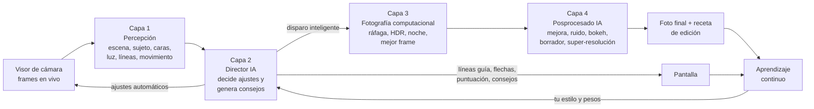
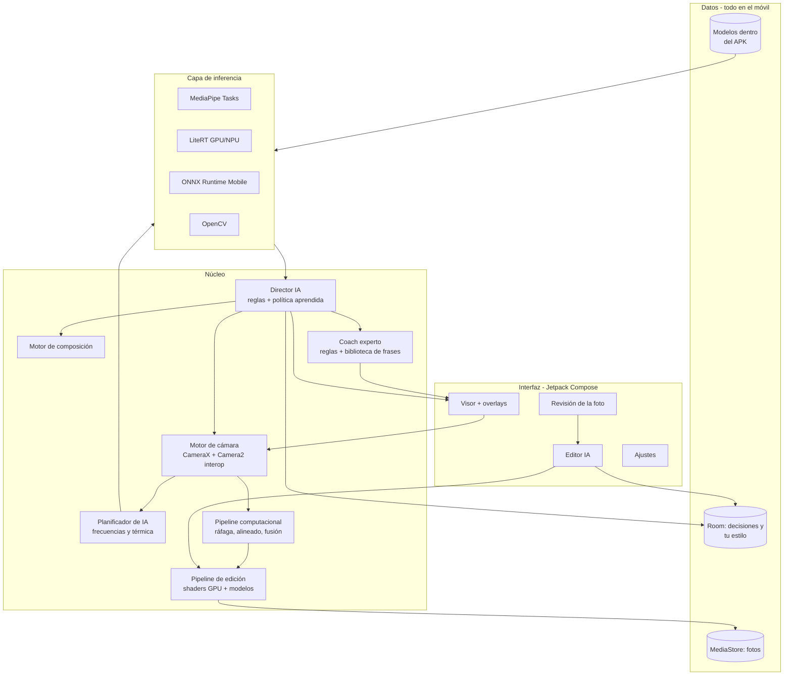

# Plan de creación — IA Cámara

> Una cámara para Android construida alrededor de la IA: analiza la escena antes de disparar,
> decide sola la mejor configuración, te guía para encuadrar como un profesional,
> aplica fotografía computacional al disparar y mejora la foto después.
> **Todo funciona dentro del móvil: sin internet, sin APIs, sin claves, sin cuentas y gratis.**

| | |
|---|---|
| **Nombre** | IA Cámara (`com.iacamara.app`) |
| **Plataforma** | Android, APK de **uso personal** |
| **Móviles objetivo** | Samsung Galaxy S22+ · Honor Magic 8 Lite |
| **Versión del plan** | 2 (noviembre de 2026) |

---

## Índice

1. [Visión, principios y alcance](#1-visión-principios-y-alcance)
2. [Tus móviles: qué permite cada uno](#2-tus-móviles-qué-permite-cada-uno)
3. [Cómo funciona la IA: las 4 capas](#3-cómo-funciona-la-ia-las-4-capas)
4. [Arquitectura técnica](#4-arquitectura-técnica)
5. [Tecnología elegida y por qué](#5-tecnología-elegida-y-por-qué)
6. [Catálogo de modelos de IA gratuitos](#6-catálogo-de-modelos-de-ia-gratuitos)
7. [Capa 1 — Percepción en vivo (antes del disparo)](#7-capa-1--percepción-en-vivo-antes-del-disparo)
8. [Capa 2 — El "Director IA": decisión autónoma](#8-capa-2--el-director-ia-decisión-autónoma)
9. [Coach de composición: líneas guía, ángulos y consejos](#9-coach-de-composición-líneas-guía-ángulos-y-consejos)
10. [Capa 3 — Fotografía computacional al disparar](#10-capa-3--fotografía-computacional-al-disparar)
11. [Capa 4 — Posprocesado con IA](#11-capa-4--posprocesado-con-ia)
12. [El "fotógrafo veterano": coach experto dentro del móvil](#12-el-fotógrafo-veterano-coach-experto-dentro-del-móvil)
13. [Aprendizaje continuo: cómo evoluciona la app](#13-aprendizaje-continuo-cómo-evoluciona-la-app)
14. [Rendimiento, batería y niveles de dispositivo](#14-rendimiento-batería-y-niveles-de-dispositivo)
15. [Experiencia de usuario y modos](#15-experiencia-de-usuario-y-modos)
16. [Privacidad, licencias y límites reales](#16-privacidad-licencias-y-límites-reales)
17. [Hoja de ruta por fases (hasta el APK v1.0)](#17-hoja-de-ruta-por-fases-hasta-el-apk-v10)
18. [Qué añadir después (versión 2 y más)](#18-qué-añadir-después-versión-2-y-más)
19. [Estructura del proyecto y cómo se generará el APK](#19-estructura-del-proyecto-y-cómo-se-generará-el-apk)
20. [Decisiones tomadas](#20-decisiones-tomadas)
21. [Fuentes consultadas](#21-fuentes-consultadas)

---

## 1. Visión, principios y alcance

**Objetivo:** que puedas sacar fotos de nivel profesional sin saber de fotografía, porque la app
"piensa" como un fotógrafo con años de experiencia: mira la escena, decide la técnica, te dice dónde
moverte, dispara en el momento justo y deja la foto en su mejor versión.

### 1.1 Regla de alcance: solo fotografía

Cada función de la app tiene que cumplir **al menos una** de estas dos condiciones:

1. **Ayuda a tomar una foto mejor** (encuadre, ángulo, luz, enfoque, exposición, momento del disparo, técnica).
2. **Mejora la calidad de la foto ya tomada** (nitidez, ruido, luz, color, rango dinámico, resolución,
   composición, fondo, defectos).

Si no cumple ninguna, **no entra en la app**. Esto también vale para los consejos: solo hablan de fotografía
y de la foto que estás haciendo o editando.

**Fuera de alcance (no se hará):** escáner de documentos, lectura de texto (OCR), códigos QR, traducción,
búsqueda u organización de la galería por contenido, redes sociales, estadísticas o "progreso" del usuario,
lecciones o retos, vídeo, reloj inteligente, versión iPhone, servicios en la nube.

### 1.2 Cero conexiones externas

- **Sin APIs externas, sin claves, sin cuentas y sin servicios en la nube.**
- La app **no tiene permiso de internet**: Android no le deja conectarse a nada, así que es imposible que
  envíe una foto o un dato.
- Todos los modelos de IA van **dentro del APK**. La app solo usa piezas del propio móvil: cámara, sensores,
  procesador gráfico y chip de IA.
- Las librerías que se nombran en este plan (CameraX, MediaPipe, LiteRT, OpenCV…) son código que se compila
  dentro de la app, como piezas de su motor; no son servicios externos.

### 1.3 Principios de diseño

| Principio | Qué significa en la práctica |
|---|---|
| **IA primero** | Por defecto la app está en modo *Auto IA*: solo apuntas; la IA decide modo, lente, exposición, enfoque, HDR, noche, ráfaga y revelado. |
| **100 % en el móvil** | Análisis, decisiones, consejos y mejoras corren en el móvil (CPU/GPU/NPU): gratis, sin conexión y sin límites. |
| **Explica lo que hace** | Cada decisión tiene un motivo visible ("contraluz → he subido la exposición y activado HDR"). |
| **Nunca estorba** | Consejos breves y visuales que se pueden ocultar. Disparo instantáneo, sin retraso. |
| **Natural, no artificial** | La mejora debe parecer una buena foto, no un filtro. Los efectos fuertes, solo si los pides. |
| **Siempre mejorando** | Aprende tu estilo en el móvil, y cada nueva versión del APK trae modelos y reglas mejores. |
| **No destructivo** | Se guarda la foto original + una "receta" de edición; toda mejora se puede deshacer. |

---

## 2. Tus móviles: qué permite cada uno

Datos **medidos** con la pantalla de diagnóstico de la app (v0.1.1). Detalle completo en
[DISPOSITIVOS.md](DISPOSITIVOS.md).

| | **Samsung Galaxy S22+** (SM-S906U) | **Honor Magic 8 Lite** (MTN-NX3) |
|---|---|---|
| Chip | Snapdragon 8 Gen 1 (SM8450) | Snapdragon 6 Gen 4 (SM6650) |
| RAM | 8 GB | 8 GB |
| Android | 16 | 16 |
| Lentes visibles para la app | Ultra gran angular 13 mm · principal 23 mm · tele 66 mm (≈3×), unidas en una cámara lógica con zoom 0,6×–10× · 2 modos frontales | Solo principal 24 mm (zoom digital 1×–8×) y frontal. **El ultra gran angular no es accesible** |
| Resolución que entrega | 12,5 MP principal · 12,2 MP ultra gran angular · 10 MP tele · 10 MP frontal | 12 MP principal · 4 MP frontal |
| 50 / 108 MP completos | **No** (reservados a la app de Samsung) | **No** (reservados a la app de Honor) |
| Extensiones del fabricante | **Auto ✓ · Retrato (bokeh) ✓ · Retoque facial ✓** · HDR ✗ · Noche ✗ | Ninguna |
| Control manual ISO / obturación | ✅ ISO 50–3200 · hasta 1/6 s (principal) | ✅ ISO 100–6400 · hasta 1/2 s |
| RAW (DNG) | ✅ en todas las lentes | ✅ |
| Ráfaga y reprocesado | ✅ | ✅ |
| Estabilizador óptico | ✅ principal y tele | No lo declara a las apps |
| Enfoque mínimo | 7 cm principal · 40 cm tele · ultra gran angular foco fijo | 9 cm |
| Ultra HDR (JPEG_R) | No | No |
| Nivel en la app (§14) | **A−** (gama alta de 2022) | **B** (gama media de 2025) |

**Estrategia para cada móvil (actualizada con los datos reales)**

- **En ambos, el modo Noche y el HDR serán los propios de la app** (ráfaga con exposición manual + alineado +
  fusión, §10), porque ningún fabricante los comparte. Es una sola vía que se optimiza para los dos móviles.
- **Galaxy S22+:** Retrato con el bokeh de Samsung (ya disponible) y, cuando sea mejor, el propio de la app.
  El Director IA preferirá el **tele 3×** para retratos. El modo **AUTO** de Samsung se compara con el procesado
  propio para elegir el mejor por escena. Cada fotograma de noche está limitado a 1/6 s, así que el modo Noche
  apilará más fotos cortas.
- **Honor Magic 8 Lite:** el pipeline propio es la única vía y la más importante. Sus 12 MP salen de agrupar
  píxeles del sensor grande (1/1,67"): poco ruido, ideal para apilar fotos de noche (hasta 1/2 s cada una).
  Sin ultra gran angular ni tele: para encuadres amplios el coach propondrá panorámica; para acercarse, la
  super-resolución multiframe en vez del zoom digital simple.
- **Android mínimo: 14.** Ambos móviles tienen Android 16.

---

## 3. Cómo funciona la IA: las 4 capas



1. **Percepción (antes del disparo):** varios modelos ligeros analizan el visor en tiempo real.
2. **Director IA (decisión):** combina todas las señales y decide la configuración de la cámara y qué
   consejo mostrar. Es el "cerebro" de la app.
3. **Fotografía computacional (en el disparo):** ráfaga, fusión HDR, noche multiframe, mejor fotograma,
   super-resolución multiframe.
4. **Posprocesado (después del disparo):** mejora automática según la escena y herramientas IA.

Más una capa transversal de **aprendizaje continuo** que ajusta al Director IA con el tiempo.

---

## 4. Arquitectura técnica



**Flujo de un frame del visor**

1. CameraX entrega dos flujos: `Preview` (lo que ves) y `ImageAnalysis` (copia reducida, ~640×480 YUV).
2. El **Planificador de IA** decide qué modelos corren en ese frame (no todos corren siempre, §14).
3. Los resultados se fusionan en un `SceneState` (escena, sujeto, caras, luz, horizonte, estabilidad…).
4. El **Director IA** transforma el `SceneState` en `CaptureSettings` (ajustes) + `Guidance` (consejos).
5. Los ajustes se aplican a la cámara de forma suave, sin saltos bruscos, y los consejos se dibujan sobre el visor.

---

## 5. Tecnología elegida y por qué

| Área | Elección | Motivo |
|---|---|---|
| Lenguaje | **Kotlin** nativo | Acceso completo a la cámara y a los aceleradores; Flutter/React Native limitan el control manual y añaden latencia. |
| Interfaz | **Jetpack Compose + Material 3** | Moderno y rápido para crear overlays animados. |
| Cámara | **CameraX** + **Camera2 Interop** | CameraX simplifica preview/captura/análisis y da acceso a las *Extensions* (HDR, Noche, Bokeh de Samsung) y a Ultra HDR; Camera2 Interop permite ISO, velocidad de obturación y enfoque manual cuando el móvil lo soporta. |
| Visión en vivo | **MediaPipe Tasks Vision** | Detector de objetos, caras con landmarks, pose, segmentación y clasificación listos para usar, con los modelos dentro del APK. |
| Modelos propios | **LiteRT** (antes TensorFlow Lite) | Runtime oficial de Google para IA en el móvil con aceleración GPU/NPU y paso automático a CPU si hace falta. |
| Modelos no convertibles | **ONNX Runtime Mobile** | Para modelos de investigación (p. ej. NAFNet) que se exportan mejor a ONNX. |
| Visión clásica | **OpenCV** | Líneas, horizonte, alineado de ráfagas, fusión de exposiciones, CLAHE, medida de nitidez. |
| Consejos | **Coach experto propio** (reglas + biblioteca de frases en español) | Sin internet ni APIs; instantáneo, fiable y siempre disponible (§12). |
| Edición GPU | **AGSL RuntimeShader** | Ajustes en tiempo real (tono, LUT, curvas) sin gastar CPU. |
| Datos | **Room** + **DataStore** | Historial de decisiones y aprendizaje de tu estilo. |
| Tareas pesadas | **WorkManager** | Procesar mejoras largas (super-resolución, noche) en segundo plano. |
| Inyección y concurrencia | **Hilt** · **Coroutines/Flow** | Arquitectura limpia y reactiva. |
| Actualizaciones | **Nueva versión del APK** | Cada versión trae dentro los modelos y las reglas mejorados; se instala encima de la anterior y conserva tu estilo aprendido. |
| Compilación | **Gradle KTS** + **GitHub Actions** | GitHub fabrica el APK por ti con cada cambio. Esto ocurre en GitHub, no dentro de la app. |

> Las versiones exactas de cada librería se fijarán al crear el proyecto (Fase 0) usando la última estable.
> Si alguna función de esas librerías aún no es estable, tendrá una alternativa estable.

---

## 6. Catálogo de modelos de IA gratuitos

Al ser de **uso personal** (la app no se distribuye), también se pueden usar modelos con licencia no comercial
o AGPL. Por eso cada modelo se elige solo por **calidad y velocidad** en tus dos móviles.

Todos van **dentro del APK**, compilado solo para procesadores de 64 bits (arm64) para ahorrar espacio.
Tamaño estimado del APK: **300–500 MB**.

### 6.1 Antes del disparo (tiempo real)

| Función | Modelo | Runtime | Notas |
|---|---|---|---|
| Tipo de escena (retrato, grupo, paisaje, ciudad, arquitectura, comida, mascota, noche, atardecer, playa/nieve, interior, flores/macro, producto, acción, cielo) | **MobileNetV3 / EfficientNet-Lite** reentrenado en categorías fotográficas · alternativa inicial: **MediaPipe Image Classifier** con mapeo a escenas | LiteRT / MediaPipe | ~3–5 MB, 2–4 veces por segundo. |
| Detección de sujetos | Se comparan en tus móviles: **MediaPipe Object Detector (EfficientDet-Lite)**, **YOLO nano (Ultralytics)** y **RF-DETR nano**; se queda el más rápido y preciso | MediaPipe / LiteRT | YOLO es AGPL, pero no hay problema en uso personal. |
| Caras, ojos abiertos, sonrisa, mirada | **MediaPipe Face Landmarker** (478 puntos + gestos faciales) | MediaPipe | Para el disparo inteligente y retratos. |
| Pose del cuerpo | **MediaPipe Pose Landmarker** | MediaPipe | No cortar en articulaciones; consejos de pose. |
| Separar sujeto y fondo | **MediaPipe Image Segmenter** (persona, pelo, piel, ropa, fondo) | MediaPipe | Base para retrato, cielo y bokeh. |
| Sujeto sin clase conocida (saliencia) | **U²-Net (versión pequeña)** | LiteRT | "¿Qué es lo importante en esta imagen?". |
| Calidad estética del encuadre | **NIMA (MobileNet) para LiteRT**, estético + técnico | LiteRT GPU | ~6,4 MB cada uno, puntuación de 1 a 10. |
| Líneas, horizonte, puntos de fuga | **OpenCV** (LSD / Hough) + sensores del móvil | OpenCV | No necesita red neuronal. |
| Profundidad en vivo | **Depth Anything V2 Small** | LiteRT / ONNX | A baja frecuencia, para retrato y macro. |

### 6.2 En el disparo

| Función | Tecnología | Notas |
|---|---|---|
| Auto / Bokeh del fabricante | **CameraX Extensions** | Solo en el S22+ (Auto, Bokeh, Retoque facial). Ningún móvil comparte HDR ni Noche. |
| HDR propio | Horquillado de exposición + alineado (OpenCV) + **fusión Mertens** + mapeo de tonos | Cuando no hay extensión o cuando el pipeline propio da mejor resultado. |
| Noche propia | Ráfaga de 6–15 frames + alineado robusto + promedio con rechazo de "fantasmas" + **Zero-DCE** | Menos ruido y sombras más limpias. |
| Mejor fotograma | Nitidez (varianza Laplaciana) + ojos abiertos + NIMA | De cada ráfaga se elige el mejor automáticamente. |
| Super-resolución multiframe | Varios frames con micro-movimientos de la mano → combinación con detalle adicional | Para el zoom digital y por si el móvil limita la resolución. |
| Ultra HDR | Formato **JPEG_R** | Más brillo y rango en pantallas HDR, compatible con JPEG normal. |
| RAW | **DNG** vía Camera2 | Modo Pro. |

### 6.3 Después del disparo

| Función | Modelo | Notas |
|---|---|---|
| Mejora en poca luz | **Zero-DCE** (LiteRT) | Diminuto (~0,18 MB), corre entero en GPU. |
| Reducción de ruido y desenfoque | **NAFNet** (denoise / deblur) | Vía ONNX Runtime, por bloques. |
| Super-resolución / zoom IA | **Real-ESRGAN x4plus** | Optimizado para NPU Snapdragon; en GPU en el resto. |
| Borrador mágico (eliminar objetos o personas) | **LaMa** · alternativa más ligera: **MI-GAN** | Relleno por bloques alrededor de la zona marcada. |
| Retrato posterior (desenfoque del fondo) | Segmentación + **Depth Anything V2 Base** + desenfoque de lente simulado | Versión *Base* (mejor calidad), permitida en uso personal. Punto de enfoque editable. |
| Cielo | Segmentación del cielo + curvas locales | Realza el cielo sin tocar el resto. |
| Recorte y enderezado inteligente | Motor de composición (§9) + NIMA | Propone 3 recortes ordenados por puntuación. |
| Color y tono por escena | Curvas + LUT 3D + balance de blancos aprendido | Shader GPU, instantáneo. |
| Corrección de perspectiva | Líneas detectadas + giroscopio guardado al disparar | Verticales rectas en arquitectura. |
| Retoque de piel natural (opcional) | MediaPipe Face Landmarker + filtro bilateral guiado | Solo si lo activas. |

### 6.4 Consejos y crítica

No se usa ninguna IA de lenguaje en la nube. Los consejos los genera un **coach experto propio** dentro del
móvil (§12) a partir de lo que miden los modelos de visión. Para dar indicaciones en tiempo real es más rápido y
fiable que un chatbot.

---

## 7. Capa 1 — Percepción en vivo (antes del disparo)

El objetivo es construir varias veces por segundo un `SceneState` con todo lo que un fotógrafo observaría
antes de disparar:

| Señal | Cómo se obtiene | Para qué sirve |
|---|---|---|
| **Tipo de escena** | Clasificador de escena suavizado en el tiempo | Elegir la estrategia general. |
| **Sujeto principal** | Caras > personas > animales > objeto detectado > mapa de saliencia | Enfocar, medir la luz y componer alrededor de él. |
| **Caras** | Face Landmarker: posición, tamaño, ojos, sonrisa, giro de cabeza | Retrato; disparar cuando todos tienen los ojos abiertos. |
| **Pose** | Pose Landmarker | No cortar en codos/rodillas, consejos de postura. |
| **Luz** | Histograma del plano Y + metadatos (ISO, exposición, temperatura de color) + sensor de luz | Contraluz, poca luz, luces quemadas, rango dinámico, luz dura o suave. |
| **Dirección de la luz** | Sombras y brillo en la cara (landmarks) + posición del sol (opcional, §9.4) | Consejos para girar al sujeto o cambiar de lado. |
| **Horizonte e inclinación** | Sensor de rotación + líneas detectadas | Nivel; verticales rectas en arquitectura. |
| **Líneas y fugas** | OpenCV LSD + agrupación de líneas | Líneas guía y simetría. |
| **Movimiento** | Giroscopio (temblor) + desplazamiento del sujeto entre frames | Velocidad de obturación, aviso "mantén quieto", modo acción. |
| **Distancia y profundidad** | Distancia de enfoque (metadatos) + modelo de profundidad a baja frecuencia | Macro, retrato, elección de lente. |
| **Calidad estética** | NIMA una vez por segundo | Parte de la puntuación de encuadre. |

**Estabilización temporal:** todas las señales se suavizan para que la escena no "parpadee" entre categorías
y los ajustes no salten. Una escena solo cambia si se mantiene ~0,5 s.

---

## 8. Capa 2 — El "Director IA": decisión autónoma

Decide como lo haría un fotógrafo profesional, en dos niveles:

1. **Motor experto de reglas** (desde el principio): conocimiento fotográfico codificado, explicable y fiable.
2. **Política aprendida** (Fase 7): pesos y preferencias que se ajustan con tu uso.

### 8.1 Qué controla de forma autónoma

- Modo de captura: normal, HDR, noche, retrato, acción, macro.
- Lente/zoom: ultra gran angular, principal, teleobjetivo 3× (S22+).
- Punto de enfoque y medición: siempre sobre el sujeto (los ojos si hay cara), con seguimiento.
- Compensación de exposición (EV) y, si el móvil lo permite, ISO y velocidad de obturación manuales.
- Balance de blancos, protegiendo tonos de piel y atardeceres.
- Flash o luz de relleno.
- Número de fotos de la ráfaga y si usa la extensión del fabricante o el pipeline propio.
- Revelado posterior: curvas, saturación y nitidez según la escena.
- Momento del disparo (disparo inteligente, §9.5).

### 8.2 Matriz de decisión inicial (ejemplos)

| Escena detectada | Señales clave | Decisión automática | Consejo mostrado |
|---|---|---|---|
| **Retrato** | Cara > 5 % del encuadre | Bokeh (extensión o propio) · enfoque y medición en los ojos · tele 3× en el S22+ · ráfaga de 5 y elegir ojos abiertos | "Baja a la altura de sus ojos" · "Deja aire sobre la cabeza" · "No cortes por rodillas o codos" |
| **Grupo** | Varias caras | Enfoque que cubra todas · ráfaga y elección del frame con todos los ojos abiertos | "Que todos estén a la misma distancia" · "Los más altos detrás" |
| **Contraluz** | Histograma bimodal, sujeto oscuro y fondo quemado | HDR · medir en el sujeto · +EV · sugerir flash de relleno | "Gira un poco para que la luz le dé de lado" |
| **Paisaje** | Escena de paisaje, sin caras, enfoque lejano | ISO mínimo · HDR si hay mucho rango dinámico · gran angular · nivel de horizonte | "Horizonte en el tercio inferior si el cielo es bonito" · "Busca algo interesante en primer plano" |
| **Poca luz / noche** | ISO alto, poca luz | Noche multiframe propio (6–15 frames según el temblor; más fotos cortas en el S22+, limitado a 1/6 s por foto) | "Apoya el móvil o mantenlo quieto 2 s" |
| **Comida** | Escena de comida | Plato plano → vista cenital (90°); vaso, hamburguesa o tarta → 45° · calidez y saturación sutiles | "Usa luz de ventana lateral, evita el flash" |
| **Arquitectura / ciudad** | Líneas verticales convergentes | Avisar de inclinación · corrección de perspectiva posterior | "Pon el móvil recto: 0° de inclinación" |
| **Acción / niños / mascotas** | Sujeto que se mueve rápido | Obturación rápida (≤ 1/500 s si hay control manual) · ráfaga · enfoque con seguimiento | "Baja a la altura del animal" |
| **Atardecer / amanecer** | Escena de atardecer, tonos cálidos | −EV para no quemar el cielo · conservar cálidos | "Pon el sol en un punto fuerte de la rejilla" |
| **Playa / nieve** | Mucha luminosidad | +EV para que la nieve/arena no salga gris · proteger luces | "Cuidado con las sombras duras en las caras" |
| **Macro / flores** | Sujeto muy cerca | Lente y distancia adecuadas · enfoque preciso · ISO bajo | "Acércate despacio hasta que se vea nítido" |
| **Producto / objeto** | Objeto aislado | Fondo desenfocado o limpio · luz suave | "Fondo sencillo y ángulo de 3/4" |

### 8.3 Cómo decide (estructura interna)

```kotlin
// Esquema simplificado del Director IA
data class SceneState(
    val scene: SceneType, val sceneConfidence: Float,
    val subject: Subject?, val faces: List<FaceInfo>,
    val light: LightInfo,          // histograma, rango dinámico, contraluz, dirección
    val motion: MotionInfo,        // temblor de la mano, velocidad del sujeto
    val horizon: HorizonInfo,      // inclinación, líneas
    val aesthetic: Float,          // NIMA
)

interface Policy { fun decide(state: SceneState, device: DeviceCaps, style: UserStyle): Decision }

data class Decision(
    val settings: CaptureSettings,  // modo, lente, EV, ISO, obturación, WB, flash, ráfaga
    val guidance: Guidance,         // líneas, flechas, puntuación, consejo
    val reasons: List<String>,      // "Contraluz detectado → +1 EV y HDR"
)
```

- `RuleBasedPolicy` (Fases 2–3) implementa la tabla anterior.
- `LearnedPolicy` (Fase 7) envuelve a la de reglas y ajusta sus parámetros con tu estilo.
- `DeviceCaps` describe lo que permite cada móvil: control manual, RAW, extensiones, lentes, aceleradores.
  **La IA nunca pide algo que el móvil no puede hacer.**

---

## 9. Coach de composición: líneas guía, ángulos y consejos

### 9.1 Líneas guía dinámicas (se adaptan a lo que detecta)

- **Rejilla de tercios**, con los 4 puntos fuertes resaltados cuando el sujeto se acerca a uno.
- **Espiral áurea / proporción áurea** cuando hay un sujeto claro y espacio negativo.
- **Eje de simetría** en escenas simétricas (arquitectura, reflejos).
- **Nivel de horizonte** (verde cuando está recto) y **nivel vertical** para arquitectura.
- **Líneas guía detectadas**, resaltadas para que las uses como camino hacia el sujeto.
- **Caja del sujeto** y **posición objetivo**: un hueco fantasma que muestra dónde debería quedar el sujeto.

**Cómo elige la IA la guía** (se puede fijar otra tocando su nombre en el visor):

| Lo que ve | Guía |
|---|---|
| Líneas que se juntan dentro de la foto (camino, vías, pasillo) | Líneas guía, con el punto de fuga al centro o en un tercio |
| Escena simétrica o reflejo en el agua (sin sujeto, o con el sujeto en el eje) | Simetría: el eje o la línea del agua al centro |
| Líneas que llevan hasta el sujeto | Líneas guía |
| Sujeto grande, primer plano o selfie | Centro |
| Sujeto pequeño con mucho espacio libre alrededor | Espiral áurea, con el sujeto en su ojo |
| Sujeto mediano | Proporción áurea (1 : 1,618) |
| Lo demás | Tercios |

Las líneas, el punto de fuga, la simetría y los reflejos se detectan sin modelos (bordes de color →
transformada de Hough; comparación de cada mitad con la otra reflejada), unas 3 veces por segundo y en
pocos milisegundos. La guía automática solo cambia cuando la escena la pide varias veces seguidas.

### 9.2 Puntuación de encuadre (0–100)

```
Puntuación = Σ peso_i(escena) × criterio_i
```

| Criterio | Qué mide |
|---|---|
| Tercios / proporción áurea | Distancia del sujeto al punto fuerte más adecuado |
| Horizonte | Inclinación y posición (tercio superior o inferior) |
| Aire sobre la cabeza | Espacio entre la cabeza y el borde superior |
| Espacio de mirada / movimiento | Más espacio hacia donde mira o se mueve el sujeto |
| Cortes | No cortar en articulaciones ni dejar el sujeto pegado al borde |
| Equilibrio visual | Reparto del "peso" visual (saliencia) en la imagen |
| Fondo limpio | Objetos que "salen" de la cabeza, elementos que distraen en los bordes |
| Exposición | Luces quemadas y sombras empastadas en el sujeto |
| Nitidez / estabilidad | Temblor y desenfoque |
| Estética global | NIMA |

Los pesos dependen de la escena (en paisaje pesa el horizonte; en retrato, los ojos y el aire sobre la cabeza)
y después se personalizan con tu estilo (§13).

### 9.3 Flechas de movimiento

El motor calcula dónde debería estar el sujeto (el punto fuerte adecuado según hacia dónde mira) y su tamaño
ideal, y lo traduce en indicaciones sencillas:

- "← Mueve el móvil un poco a la izquierda" · "Acércate" / "Aléjate" · "Baja la cámara" · "Gira a horizontal".
- Vibración suave cuando el encuadre llega a la zona óptima.
- Guía por voz opcional, para no tener que mirar la pantalla.

### 9.4 Consejos de ángulo y de luz por escena

Biblioteca de conocimiento fotográfico, ampliable en cada nueva versión. Ejemplos:

- **Retrato:** a la altura de los ojos; ligero ángulo de 3/4; luz lateral suave; evitar el sol del mediodía.
- **Grupo:** todos a la misma distancia; los más altos detrás; disparo en ráfaga.
- **Paisaje:** primer plano + plano medio + fondo; hora dorada; horizonte recto.
- **Comida:** cenital para platos planos, 45° para comida con altura; luz de ventana.
- **Arquitectura:** móvil vertical para no deformar; buscar simetría o diagonales.
- **Mascotas y niños:** a su altura; ráfaga; enfocar los ojos.
- **Producto:** fondo limpio; luz difusa; ángulo de 3/4.
- **Noche:** apoyar el móvil; evitar el zoom digital; buscar fuentes de luz en el encuadre.
- **Luz del sol (opcional, con GPS):** la app calcula la posición del sol con fórmulas astronómicas, sin
  internet, y avisa de la hora dorada y la hora azul ("la hora dorada empieza en 25 min"), o de que el sol está detrás del sujeto. La ubicación solo se
  usa para este cálculo y no se guarda en las fotos.

### 9.5 Disparo inteligente (opcional)

La app dispara sola, o te avisa, cuando se cumplen a la vez: puntuación ≥ umbral, móvil estable ~300 ms,
enfoque bloqueado, ojos abiertos y, si procede, sonrisa. En grupos espera a que **todos** tengan los ojos
abiertos.

---

## 10. Capa 3 — Fotografía computacional al disparar

1. **Cero retraso de obturador:** CameraX en modo de mínima latencia, con un búfer de frames recientes.
2. **Estrategia elegida por el Director IA:**
   - Si hay **extensión** del fabricante adecuada (HDR, Noche, Bokeh) y da mejor resultado → se usa.
   - Si no → **pipeline propio**:
     - *HDR:* 3 exposiciones (−2, 0, +2 EV) → alineado → fusión Mertens → mapeo de tonos.
     - *Noche:* 6–15 frames cortos → alineado robusto → promedio con rechazo de fantasmas → Zero-DCE + reducción de ruido.
     - *Acción / retrato:* ráfaga corta → se elige el frame más nítido y con los ojos abiertos.
     - *Zoom:* super-resolución multiframe en lugar de zoom digital simple.
3. **Formato:** JPEG de alta calidad, **Ultra HDR (JPEG_R)** y **RAW (DNG)** en el modo Pro.
4. **Metadatos:** EXIF completo + datos de la decisión de la IA (escena, motivo, giroscopio) para el editor y el aprendizaje.
5. **Vista inmediata:** se muestra una vista previa al instante y el procesamiento pesado continúa en segundo plano.

---

## 11. Capa 4 — Posprocesado con IA

> **Cambio de rumbo (Fase 5):** las galerías de Samsung y Honor ya incluyen borrador de objetos, mejora manual,
> desenfoque de fondo posterior y filtros. La Fase 5 se centra en lo que solo la cámara puede hacer porque tiene la
> ráfaga, los sensores y el análisis de la escena en el momento del disparo (ver la hoja de ruta, §17). La mejora
> automática sí se mantiene: se aplica sola al disparar, con la receta de la escena detectada.

### 11.1 Mejora automática (sin tocar nada)

Tras cada foto se aplica una "receta" según la escena y tu estilo: balance de blancos, curvas, contraste local
(CLAHE), saturación selectiva, protección de tonos de piel, nitidez adaptativa y reducción de ruido. Se guarda
**original + versión mejorada**.

### 11.2 Herramientas del editor

| Herramienta | Qué hace |
|---|---|
| **Mejorar ✨** | Un toque: la mejor versión según la IA, con intensidad ajustable. |
| **Luz IA** | Recupera sombras en fotos oscuras (Zero-DCE). |
| **Nitidez / Sin ruido** | NAFNet para ruido y desenfoque leve. |
| **Zoom IA** | Super-resolución ×2/×4 (Real-ESRGAN). |
| **Retrato** | Desenfoque del fondo con profundidad; cambiar el punto de enfoque después. |
| **Borrador mágico** | Elimina personas u objetos que molestan (LaMa / MI-GAN). |
| **Recorte inteligente** | 3 propuestas de recorte + enderezado automático de horizonte y perspectiva. |
| **Cielo** | Realza el cielo sin afectar al resto. |
| **Estilos** | LUTs de cine y de película adaptados a cada escena. |
| **Intenciones** | Botones como "Más cálida", "Más dramática", "Más luminosa" o "Aire de película": la IA traduce cada intención a los ajustes adecuados para esa foto concreta. |
| **Crítica del fotógrafo** | Qué está bien, qué falla y cómo hacerla mejor la próxima vez (§12). |

Todo es **no destructivo**: la edición es una lista de pasos guardada junto a la foto.

---

## 12. El "fotógrafo veterano": coach experto dentro del móvil

Sin APIs ni nube: el coach es un **sistema experto propio** que convierte lo que miden los modelos de visión en
consejos claros en español.

- **Cómo funciona:** el `SceneState` (escena, sujeto, luz, encuadre, estabilidad) pasa por una base de reglas
  fotográficas. Cada regla que se cumple genera un consejo con una prioridad, y la app muestra solo el más
  importante en cada momento para no saturarte.
- **Biblioteca de frases:** cientos de consejos redactados como los daría un fotógrafo con experiencia, con
  variantes para que no suenen repetitivos. Ejemplos:
  - "La luz te viene de frente y aplana la cara: gira a la persona hacia la ventana."
  - "El horizonte corta la foto por la mitad: bájalo al tercio inferior, el cielo es lo bonito."
  - "Hay una farola saliendo de su cabeza: da un paso a la derecha."
- **Crítica del fotógrafo** después de la foto: puntuación por apartados (composición, luz, nitidez, momento,
  color) calculada con medidas reales y NIMA, más 2–3 consejos concretos para la próxima vez.
- **Corrección de hábitos:** detecta tus errores repetidos (horizontes torcidos, sujetos siempre centrados,
  fotos movidas) y la app los compensa en el disparo o te avisa justo en ese momento.
- **Explica cada decisión:** "He usado el modo Noche con 10 fotos porque hay poca luz y el móvil está estable".
- **Solo fotografía:** el coach no tiene ninguna otra función que ayudarte a tomar y mejorar fotos.
- **Ventajas frente a un chatbot:** responde al instante, funciona sin internet, no se inventa cosas y no gasta
  batería en un modelo de lenguaje grande.
- **Límite:** los consejos salen de un catálogo amplio pero cerrado; no es una conversación libre con la app.

---

## 13. Aprendizaje continuo: cómo evoluciona la app

Un móvil no puede reentrenar redes neuronales grandes cada día. La app aprende de dos formas realistas y
complementarias:

### 13.1 Tu estilo (en tu móvil, privado)

- Se registran **eventos** en Room: consejos aceptados o ignorados, qué foto de la ráfaga conservas, qué fotos
  borras, qué ajustes cambias en el editor y valoraciones 👍/👎 de los consejos y las mejoras.
- **"Tu estilo":** un modelo ligero aprende tus ajustes habituales por escena (p. ej. "le gustan los retratos
  más cálidos y con menos contraste") y los aplica en la mejora automática.
- **Bandido contextual** (Thompson sampling): elige entre variantes de ajustes y consejos según el contexto y
  refuerza las que más te gustan. Ligero, rápido y explicable.
- **Consejos adaptativos:** si ya dominas los tercios, deja de recordártelos y se centra en lo que aún falla.
- Las críticas del coach también alimentan este aprendizaje (qué aspectos fallan más en tus fotos).

### 13.2 Nuevas versiones

- Cada nueva versión del APK trae modelos mejores, nuevas reglas del Director IA, pesos de composición
  ajustados y más consejos, **todo dentro del APK**.
- Al instalarla encima de la anterior se conserva todo lo que la app ha aprendido de tu estilo.
- Más adelante: **modelos ajustados con tus propias fotos favoritas**, entrenados dentro del móvil (§18).

---

## 14. Rendimiento, batería y niveles de dispositivo

### 14.1 Planificador de IA (no todo corre en cada frame)

| Tarea | Frecuencia | Latencia objetivo |
|---|---|---|
| Histograma / exposición | Cada frame | < 2 ms |
| Caras y landmarks | 15–30 fps | < 15 ms |
| Detección de sujetos | ~10 fps | < 30 ms |
| Segmentación | 5–10 fps | < 30 ms |
| Clasificación de escena | 2–4 fps | < 20 ms |
| Líneas / horizonte | ~5 fps | < 15 ms |
| Estética (NIMA) | ~1 fps | ~100 ms |
| Coach experto (reglas) | 2–5 veces por segundo | < 1 ms |

- Si el móvil se calienta (Android avisa de la temperatura), el planificador baja frecuencias y resolución.
  Importante en el S22+, cuyo chip tiende a calentarse.
- Aceleración: NPU → GPU → CPU, con paso automático en LiteRT.
- Modelos cuantizados (fp16/int8), **comprobando** que la cuantización no introduce bandas ni cambios de color
  en los modelos de mejora de imagen.

### 14.2 Niveles de dispositivo

| Nivel | Tus móviles | Qué se activa |
|---|---|---|
| **A−** | Galaxy S22+ | Toda la visión en vivo, Auto y Bokeh de Samsung, posprocesado completo en GPU. |
| **B** | Honor Magic 8 Lite | Visión en vivo completa a algo menos de frecuencia; posprocesado pesado en segundo plano; NPU para super-resolución si es compatible. |

La app mide el móvil la primera vez (mini-benchmark de unos 5 s) y ajusta el nivel automáticamente.

---

## 15. Experiencia de usuario y modos

**Pantalla principal:** visor a pantalla completa · indicador de escena ("🌅 Atardecer · HDR") · puntuación de
encuadre · líneas guía dinámicas · un consejo breve · botón de disparo · selector de lente.

| Modo | Comportamiento |
|---|---|
| **Auto IA** (por defecto) | La IA decide todo; consejos mínimos. |
| **Guiado** | Consejos, flechas y el motivo de cada decisión. |
| **Retrato · Noche · Paisaje · Comida · Acción · Macro** | Fuerza la estrategia de esa escena. |
| **Pro** | ISO, obturación, enfoque, balance de blancos y RAW manuales, con la sugerencia de la IA al lado. |

**Pantallas:** visor · revisión de la última foto (comparar original y mejorada) · editor IA · ajustes
(guía por voz, disparo inteligente, posición del sol, intensidad de la mejora automática).
Para ver todas tus fotos se usa la galería normal del móvil; la app abre cualquier foto en su editor.

---

## 16. Privacidad, licencias y límites reales

**Privacidad**
- Todo se hace en el móvil y la app no tiene permiso de internet: ninguna foto ni dato sale nunca del teléfono.
- Permisos: cámara (obligatorio) y ubicación (opcional, solo para calcular la posición del sol).

**Licencias**
- Al ser de uso personal y no distribuirse, se pueden usar modelos AGPL o no comerciales. Si algún día quisieras
  publicarla, habría que revisar y sustituir esos modelos.

**Límites reales (para no prometer de más)**
- Las apps de terceros no tienen acceso a todo el procesado interno de la cámara de Samsung u Honor. Por eso se
  usan las extensiones cuando existen y un pipeline propio cuando no.
- La resolución máxima, el control manual y el RAW dependen de lo que cada fabricante abra a otras apps; se mide
  en la Fase 1.
- En el S22+ el tele y el ultra gran angular se usan a través de la cámara lógica (zoom 0,6×–10×). En el Honor solo
  es accesible la cámara principal.
- Al llevar todos los modelos dentro, el APK será grande (unos 300–500 MB).
- El emulador de Android no sirve para probar la cámara: todas las pruebas se harán en tus dos móviles.

---

## 17. Hoja de ruta por fases (hasta el APK v1.0)

Cada fase termina con un **APK instalable** para probar en tus dos móviles.

| Fase | Contenido | Entregable | Criterio de "terminado" |
|---|---|---|---|
| **0 — Base** | Proyecto Kotlin con Compose (se divide en módulos cuando llegue la IA); GitHub Actions que genera el APK firmado siempre con la misma clave (para que cada versión se instale encima de la anterior); permisos, sin permiso de internet | APK v0.0 | El APK se descarga desde GitHub y abre la cámara en ambos móviles. |
| **1 — Cámara sólida** | Visor, captura, lentes y zoom, flash, toque para enfocar, rejilla, nivel con sensores, guardado con EXIF; pantalla interna de diagnóstico que muestra qué permite cada móvil (extensiones, RAW, resolución, control manual) | **APK v0.1** | Fotos sin retraso; sabemos con datos reales qué ofrece el S22+ y qué el Honor. |
| **2 — Percepción en vivo** | Planificador de IA, escena, sujeto, caras, pose, histograma y luz; enfoque y exposición automáticos sobre el sujeto; uso de extensiones | **APK v0.2** | Reconoce ≥ 12 tipos de escena y enfoca solo al sujeto. |
| **3 — Coach de composición** | Motor de composición, líneas guía dinámicas, flechas, puntuación, consejos por escena, posición del sol, disparo inteligente, Director IA por reglas | **APK v0.3** | Te guía hasta un encuadre con puntuación alta. |
| **4 — Computacional** | Ráfaga + mejor frame, HDR propio, noche multiframe, modo Pro (Ultra HDR descartado: ninguno de los dos móviles lo admite; super-resolución y RAW pasan a la Fase 5) | **APK v0.4** | Mejora visible en contraluz, noche y zoom frente a una foto simple. |
| **5 — Lo que solo la cámara puede hacer** | Mejora automática por escena al disparar (original + mejorada), enderezado y perspectiva con el sensor del disparo, recorte según la guía del coach, todos con los ojos abiertos en fotos de grupo, quitar gente que pasa, larga exposición, zoom con más detalle usando varias fotos, RAW (DNG) en PRO. Las herramientas que ya traen las galerías de Samsung y Honor (borrador, desenfoque posterior, filtros) no se repiten | **APK v0.5** | Funciones que la galería no puede hacer, funcionando en ambos móviles. |
| **6 — Fotógrafo veterano** | Coach experto completo: base de reglas, biblioteca de frases, crítica del fotógrafo, explicación de decisiones, corrección de hábitos (las intenciones de edición se descartan: lo hacen las galerías de Samsung y Honor) | **APK v0.6** | Explica cada foto y da consejos útiles, todo sin conexión. |
| **7 — Aprendizaje** | Registro de eventos, "Tu estilo", bandido contextual, 👍/👎, conservación de lo aprendido entre versiones. Hecho así: tu estilo por grupo de escenas (calidez, color, contraste, luz) aplicado a la mejora automática; «Afinar mi estilo» (elegir entre tres versiones de la misma foto, como en el óptico: la simulación mostró que con 👍/👎 sueltos hacen falta muchas decenas de valoraciones por ajuste, y comparando, unas 20 elecciones en total); 👍/👎 con versiones elegidas por muestreo de Thompson; lo que borras; consejos silenciados, frase que te funciona y lo que ya dominas; firma fija para conservarlo | **APK v0.7** | La mejora automática se adapta a tus gustos tras ~50 fotos (o tras una prueba de gusto). |
| **8 — Pulido** | Optimización de velocidad, temperatura y batería en el S22+ y el Honor; estabilidad; ajuste fino de cada modelo. **Modelos pendientes** (necesitan un permiso que se da desde el ordenador): **MobileCLIP2-S0** en lugar de TinyCLIP (sus pesos solo están en Hugging Face y en el servidor de Apple, que la red del entorno de compilación no alcanza) y **YOLO26s** en lugar de YOLO11s (exportarlo exige abrir el archivo de pesos de PyTorch descargado, que el entorno bloquea por seguridad) | **APK v1.0** | Fluida, estable y sin calentamiento excesivo. |

**Pruebas en todas las fases:** tests unitarios del motor de composición y del Director IA, benchmarks de
rendimiento en tus dos móviles y un conjunto de fotos de referencia para comprobar que las mejoras de imagen no
empeoran entre versiones.

---

## 18. Qué añadir después (versión 2 y más)

Todo centrado en tomar mejores fotos o mejorar su calidad:

- **Astrofotografía:** exposiciones largas con el móvil apoyado y alineado de estrellas.
- **Panorámica guiada** con corrección de exposición entre tomas.
- **Larga exposición simulada:** agua sedosa, estelas de luz, eliminar gente en movimiento.
- **Apilado de enfoque** (focus stacking) para macro totalmente nítido.
- **Reiluminación de retratos:** cambiar la dirección de la luz después de la foto.
- **Ampliar la foto (outpainting)** para arreglar encuadres demasiado justos.
- **Temporizador inteligente por gesto** para autorretratos y fotos de grupo (dispara cuando todos miran).
- **Modelo de lenguaje dentro del móvil** (p. ej. Gemma) para preguntar libremente sobre la foto, sin internet;
  solo si cabe en el APK y va fluido en tus móviles.
- **Modelos entrenados con tus propias fotos favoritas** para que la mejora automática sea exactamente tu estilo.

---

## 19. Estructura del proyecto y cómo se generará el APK

```
IA-C-mara-/
├── app/                      # Aplicación Android (punto de entrada, navegación)
├── core/
│   ├── camera/               # CameraX, Camera2 interop, extensiones, capacidades del móvil
│   ├── ai/                   # MediaPipe, LiteRT, ONNX, OpenCV; planificador
│   ├── director/             # SceneState, políticas (reglas y aprendida), decisiones
│   ├── composition/          # Motor de composición y puntuación
│   ├── imaging/              # Pipeline computacional y de edición (shaders, fusión)
│   ├── coach/                # Coach experto: reglas y biblioteca de frases
│   └── data/                 # Room, DataStore, MediaStore
├── feature/
│   ├── viewfinder/           # Visor y overlays
│   ├── review/               # Revisión de la foto (original vs. mejorada)
│   ├── editor/               # Editor IA
│   └── settings/             # Ajustes
├── models/                   # Todos los modelos .tflite/.onnx (van dentro del APK)
├── docs/
│   └── PLAN.md               # Este documento
└── .github/workflows/        # CI: compila y publica el APK
```

**Generación del APK sin instalar nada:** GitHub Actions compila el proyecto con cada cambio y deja el APK
descargable en la pestaña *Actions* del repositorio (y en *Releases* para cada versión). Para instalarlo:
descargarlo en el móvil y permitir "instalar apps desconocidas" para el navegador o el gestor de archivos.
GitHub solo se usa para fabricar el APK; la app nunca se conecta a GitHub ni a ningún otro sitio.

---

## 20. Decisiones tomadas

| Decisión | Valor |
|---|---|
| Nombre e identificador | **IA Cámara** · `com.iacamara.app` |
| Uso | Personal (APK directo, sin Google Play) |
| Móviles de prueba | Samsung Galaxy S22+ y Honor Magic 8 Lite |
| Android mínimo | Android 14 |
| Idioma | Español |
| Alcance | Solo funciones para tomar mejores fotos o mejorar su calidad (§1.1) |
| Conexiones externas | **Ninguna**: sin APIs, sin claves, sin cuentas, sin nube y sin permiso de internet (§1.2) |
| Consejos | Coach experto propio dentro del móvil (§12) |
| Actualizaciones | Nueva versión del APK instalada encima de la anterior |
| Licencias de modelos | Se elige el mejor modelo sin restricciones de licencia comercial (uso personal) |

---

## 21. Fuentes consultadas

- [Versiones de CameraX (Android Developers)](https://developer.android.com/jetpack/androidx/releases/camera)
- [Extensiones de cámara (AOSP)](https://source.android.com/docs/core/camera/camerax-vendor-extensions)
- [Samsung abre las extensiones de cámara del Galaxy S22 a apps de terceros (SamMobile)](https://www.sammobile.com/news/samsung-supports-3rd-party-camera-app-devs-better-than-google)
- [RAW con Camera2 en el Galaxy S22 (foro de desarrolladores de Samsung)](https://forum.developer.samsung.com/t/data-range-and-number-of-bits-of-raw-images-dng/23207)
- [Acceso al teleobjetivo desde apps de terceros (foro de desarrolladores de Samsung)](https://forum.developer.samsung.com/t/telephoto-access-via-third-party-application/42137)
- [Ficha técnica del Honor Magic 8 Lite (TuttoAndroid)](https://www.tuttoandroid.net/schede-tecniche/honor-magic8-lite_5176/) · [Análisis (Notebookcheck)](https://www.notebookcheck.net/Rugged-does-not-have-to-mean-a-brick-Honor-Magic8-Lite-review.1206677.0.html)
- [Ultra HDR en Android (AOSP)](https://source.android.com/docs/core/camera/ultra-hdr) · [Ultra HDR en CameraX (Android Central)](https://www.androidcentral.com/apps-software/google-adding-ultra-hdr-image-capture-to-camerax-api)
- [LiteRT (Google Developers Blog)](https://developers.googleblog.com/en/litert-the-universal-framework-for-on-device-ai/) · [LiteRT Next](https://ai.google.dev/edge/litert/next/overview)
- [MediaPipe Solutions guide](https://developers.google.com/edge/mediapipe/solutions/guide)
- [NIMA para LiteRT (Hugging Face)](https://huggingface.co/litert-community/NIMA-LiteRT) · [idealo image-quality-assessment](https://github.com/idealo/image-quality-assessment) · [Paper NIMA](https://arxiv.org/pdf/1709.05424)
- [Zero-DCE para LiteRT (Hugging Face)](https://huggingface.co/mlboydaisuke/zero-dce-litert)
- [Real-ESRGAN x4plus (Qualcomm AI Hub)](https://huggingface.co/qualcomm/Real-ESRGAN-x4plus/raw/main/README.md)
- [Alternativas a Ultralytics en 2026 (Lightly)](https://lightly.ai/blog/best-ultralytics-alternatives-in-2026)